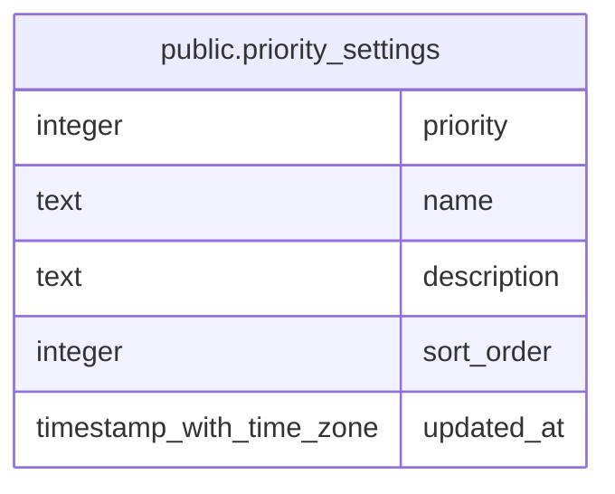

# public.priority_settings

## Description

Display names, descriptions, and ordering for the fixed task priorities.

## Columns

| Name        | Type                     | Default | Nullable | Children | Parents | Comment                                            |
| ----------- | ------------------------ | ------- | -------- | -------- | ------- | -------------------------------------------------- |
| priority    | integer                  |         | true     |          |         | Fixed task priority value; null represents Inbox.  |
| name        | text                     |         | false    |          |         | Display name used for the priority.                |
| description | text                     |         | false    |          |         | Description shown for the priority.                |
| sort_order  | integer                  |         | false    |          |         | Position of the priority in user-configured order. |
| updated_at  | timestamp with time zone | now()   | false    |          |         |                                                    |

## Constraints

| Name                                   | Type  | Definition                                                                        |
| -------------------------------------- | ----- | --------------------------------------------------------------------------------- |
| priority_settings_description_not_null | n     | NOT NULL description                                                              |
| priority_settings_name_not_null        | n     | NOT NULL name                                                                     |
| priority_settings_priority_check       | CHECK | CHECK (((priority IS NULL) OR ((priority >= '-1'::integer) AND (priority <= 2)))) |
| priority_settings_sort_order_not_null  | n     | NOT NULL sort_order                                                               |
| priority_settings_updated_at_not_null  | n     | NOT NULL updated_at                                                               |

## Indexes

| Name                                | Definition                                                                                                                            |
| ----------------------------------- | ------------------------------------------------------------------------------------------------------------------------------------- |
| priority_settings_priority_unique   | CREATE UNIQUE INDEX priority_settings_priority_unique ON public.priority_settings USING btree (priority) WHERE (priority IS NOT NULL) |
| priority_settings_inbox_unique      | CREATE UNIQUE INDEX priority_settings_inbox_unique ON public.priority_settings USING btree (priority) WHERE (priority IS NULL)        |
| priority_settings_sort_order_unique | CREATE UNIQUE INDEX priority_settings_sort_order_unique ON public.priority_settings USING btree (sort_order)                          |

## Relations

---

> Generated by [tbls](https://github.com/k1LoW/tbls)
