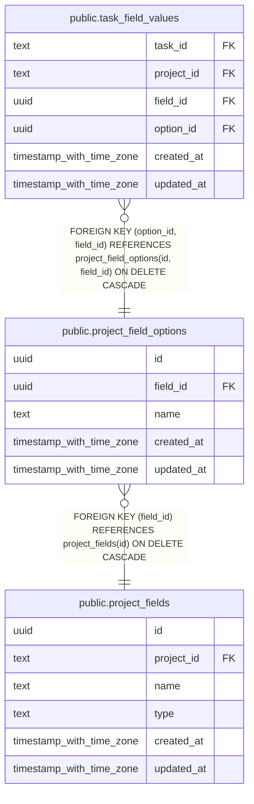

# public.project_field_options

## Description

Selectable options defined for a project custom field.

## Columns

| Name       | Type                     | Default  | Nullable | Children                                                | Parents                                           | Comment                                     |
| ---------- | ------------------------ | -------- | -------- | ------------------------------------------------------- | ------------------------------------------------- | ------------------------------------------- |
| id         | uuid                     | uuidv7() | false    | [public.task_field_values](public.task_field_values.md) |                                                   |                                             |
| field_id   | uuid                     |          | false    | [public.task_field_values](public.task_field_values.md) | [public.project_fields](public.project_fields.md) | Custom field that owns this option.         |
| name       | text                     |          | false    |                                                         |                                                   | Unique option name within the custom field. |
| created_at | timestamp with time zone | now()    | false    |                                                         |                                                   |                                             |
| updated_at | timestamp with time zone | now()    | false    |                                                         |                                                   |                                             |

## Constraints

| Name                                                | Type        | Definition                                                             |
| --------------------------------------------------- | ----------- | ---------------------------------------------------------------------- |
| project_field_options_created_at_not_null           | n           | NOT NULL created_at                                                    |
| project_field_options_field_id_not_null             | n           | NOT NULL field_id                                                      |
| project_field_options_id_not_null                   | n           | NOT NULL id                                                            |
| project_field_options_name_not_null                 | n           | NOT NULL name                                                          |
| project_field_options_updated_at_not_null           | n           | NOT NULL updated_at                                                    |
| project_field_options_pkey                          | PRIMARY KEY | PRIMARY KEY (id)                                                       |
| uq_project_field_options_field_id_name              | UNIQUE      | UNIQUE (field_id, name)                                                |
| uq_project_field_options_id_field_id                | UNIQUE      | UNIQUE (id, field_id)                                                  |
| project_field_options_field_id_project_fields_id_fk | FOREIGN KEY | FOREIGN KEY (field_id) REFERENCES project_fields(id) ON DELETE CASCADE |

## Indexes

| Name                                   | Definition                                                                                                              |
| -------------------------------------- | ----------------------------------------------------------------------------------------------------------------------- |
| project_field_options_pkey             | CREATE UNIQUE INDEX project_field_options_pkey ON public.project_field_options USING btree (id)                         |
| uq_project_field_options_field_id_name | CREATE UNIQUE INDEX uq_project_field_options_field_id_name ON public.project_field_options USING btree (field_id, name) |
| uq_project_field_options_id_field_id   | CREATE UNIQUE INDEX uq_project_field_options_id_field_id ON public.project_field_options USING btree (id, field_id)     |

## Relations

---

> Generated by [tbls](https://github.com/k1LoW/tbls)
