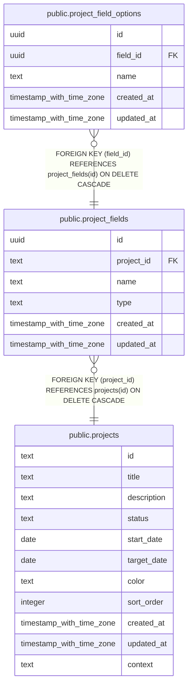

# public.project_fields

## Description

Single-select custom field definitions scoped to a project.

## Columns

| Name       | Type                     | Default               | Nullable | Children                                                        | Parents                               | Comment                                                |
| ---------- | ------------------------ | --------------------- | -------- | --------------------------------------------------------------- | ------------------------------------- | ------------------------------------------------------ |
| id         | uuid                     | uuidv7()              | false    | [public.project_field_options](public.project_field_options.md) |                                       |                                                        |
| project_id | text                     |                       | false    |                                                                 | [public.projects](public.projects.md) | Project that owns this custom field.                   |
| name       | text                     |                       | false    |                                                                 |                                       | Unique field name within the project.                  |
| type       | text                     | 'single_select'::text | false    |                                                                 |                                       | Field type; currently only single_select is supported. |
| created_at | timestamp with time zone | now()                 | false    |                                                                 |                                       |                                                        |
| updated_at | timestamp with time zone | now()                 | false    |                                                                 |                                       |                                                        |

## Constraints

| Name                                     | Type        | Definition                                                         |
| ---------------------------------------- | ----------- | ------------------------------------------------------------------ |
| project_fields_created_at_not_null       | n           | NOT NULL created_at                                                |
| project_fields_id_not_null               | n           | NOT NULL id                                                        |
| project_fields_name_not_null             | n           | NOT NULL name                                                      |
| project_fields_project_id_not_null       | n           | NOT NULL project_id                                                |
| project_fields_type_check                | CHECK       | CHECK ((type = 'single_select'::text))                             |
| project_fields_type_not_null             | n           | NOT NULL type                                                      |
| project_fields_updated_at_not_null       | n           | NOT NULL updated_at                                                |
| project_fields_project_id_projects_id_fk | FOREIGN KEY | FOREIGN KEY (project_id) REFERENCES projects(id) ON DELETE CASCADE |
| project_fields_pkey                      | PRIMARY KEY | PRIMARY KEY (id)                                                   |
| uq_project_fields_project_id_name        | UNIQUE      | UNIQUE (project_id, name)                                          |
| uq_project_fields_id_project_id          | UNIQUE      | UNIQUE (id, project_id)                                            |

## Indexes

| Name                              | Definition                                                                                                    |
| --------------------------------- | ------------------------------------------------------------------------------------------------------------- |
| project_fields_pkey               | CREATE UNIQUE INDEX project_fields_pkey ON public.project_fields USING btree (id)                             |
| uq_project_fields_project_id_name | CREATE UNIQUE INDEX uq_project_fields_project_id_name ON public.project_fields USING btree (project_id, name) |
| uq_project_fields_id_project_id   | CREATE UNIQUE INDEX uq_project_fields_id_project_id ON public.project_fields USING btree (id, project_id)     |

## Relations

---

> Generated by [tbls](https://github.com/k1LoW/tbls)
