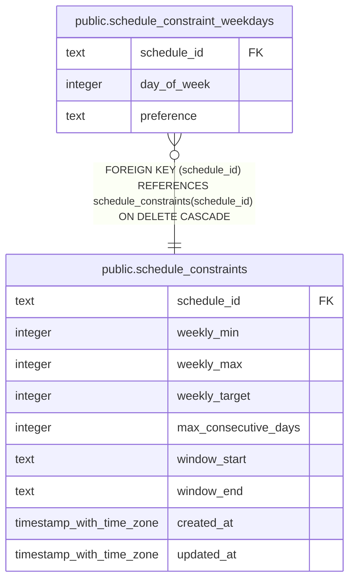

# public.schedule_constraint_weekdays

## Description

Per-weekday scheduling preferences for a schedule constraint; weekdays without rows are preferred.

## Columns

| Name        | Type    | Default | Nullable | Children | Parents                                                       | Comment                                                          |
| ----------- | ------- | ------- | -------- | -------- | ------------------------------------------------------------- | ---------------------------------------------------------------- |
| schedule_id | text    |         | false    |          | [public.schedule_constraints](public.schedule_constraints.md) | Schedule constraint that owns this weekday preference.           |
| day_of_week | integer |         | false    |          |                                                               | Day of week from 0 (Sunday) through 6 (Saturday).                |
| preference  | text    |         | false    |          |                                                               | Scheduling preference: preferred, if_free, reserve, or excluded. |

## Constraints

| Name                                                    | Type        | Definition                                                                                                |
| ------------------------------------------------------- | ----------- | --------------------------------------------------------------------------------------------------------- |
| schedule_constraint_weekdays_day_of_week_check          | CHECK       | CHECK (((day_of_week >= 0) AND (day_of_week <= 6)))                                                       |
| schedule_constraint_weekdays_day_of_week_not_null       | n           | NOT NULL day_of_week                                                                                      |
| schedule_constraint_weekdays_preference_check           | CHECK       | CHECK ((preference = ANY (ARRAY['preferred'::text, 'if_free'::text, 'reserve'::text, 'excluded'::text]))) |
| schedule_constraint_weekdays_preference_not_null        | n           | NOT NULL preference                                                                                       |
| schedule_constraint_weekdays_schedule_id_not_null       | n           | NOT NULL schedule_id                                                                                      |
| schedule_constraint_weekdays_schedule_id_day_of_week_pk | PRIMARY KEY | PRIMARY KEY (schedule_id, day_of_week)                                                                    |
| schedule_constraint_weekdays_constraint_fk              | FOREIGN KEY | FOREIGN KEY (schedule_id) REFERENCES schedule_constraints(schedule_id) ON DELETE CASCADE                  |

## Indexes

| Name                                                    | Definition                                                                                                                                                |
| ------------------------------------------------------- | --------------------------------------------------------------------------------------------------------------------------------------------------------- |
| schedule_constraint_weekdays_schedule_id_day_of_week_pk | CREATE UNIQUE INDEX schedule_constraint_weekdays_schedule_id_day_of_week_pk ON public.schedule_constraint_weekdays USING btree (schedule_id, day_of_week) |

## Relations

---

> Generated by [tbls](https://github.com/k1LoW/tbls)
