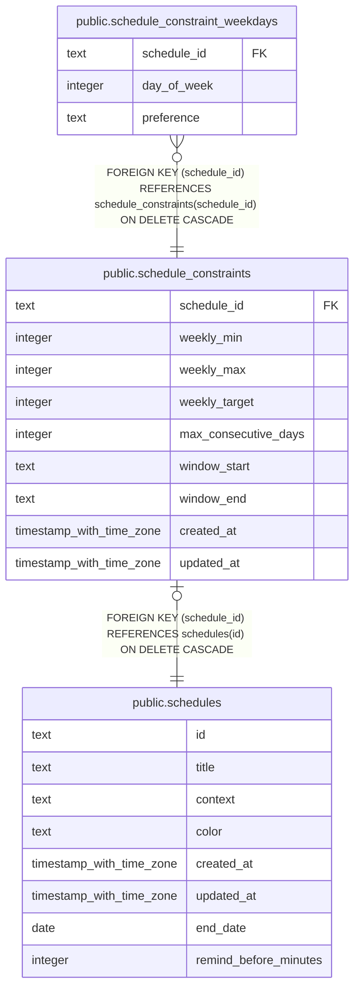

# public.schedule_constraints

## Description

Optional weekly frequency, consecutive-day, and time-window constraints for a calendar schedule.

## Columns

| Name                 | Type                     | Default | Nullable | Children                                                                      | Parents                                 | Comment                                                                                      |
| -------------------- | ------------------------ | ------- | -------- | ----------------------------------------------------------------------------- | --------------------------------------- | -------------------------------------------------------------------------------------------- |
| schedule_id          | text                     |         | false    | [public.schedule_constraint_weekdays](public.schedule_constraint_weekdays.md) | [public.schedules](public.schedules.md) | Schedule series whose constraints are stored here.                                           |
| weekly_min           | integer                  |         | true     |                                                                               |                                         | Minimum number of non-skipped occurrences per Monday-based week; null means no minimum.      |
| weekly_max           | integer                  |         | true     |                                                                               |                                         | Maximum number of non-skipped occurrences per Monday-based week; null means no maximum.      |
| weekly_target        | integer                  |         | true     |                                                                               |                                         | Preferred number of occurrences per Monday-based week; null means no target.                 |
| max_consecutive_days | integer                  |         | true     |                                                                               |                                         | Maximum number of consecutive local dates that may contain occurrences; null means no limit. |
| window_start         | text                     |         | true     |                                                                               |                                         | Local start time in 24-hour HH:MM format; null with window_end disables the time window.     |
| window_end           | text                     |         | true     |                                                                               |                                         | Local end time in 24-hour HH:MM format; null with window_start disables the time window.     |
| created_at           | timestamp with time zone | now()   | false    |                                                                               |                                         |                                                                                              |
| updated_at           | timestamp with time zone | now()   | false    |                                                                               |                                         |                                                                                              |

## Constraints

| Name                                             | Type        | Definition                                                                                          |
| ------------------------------------------------ | ----------- | --------------------------------------------------------------------------------------------------- |
| schedule_constraints_created_at_not_null         | n           | NOT NULL created_at                                                                                 |
| schedule_constraints_max_consecutive_days_check  | CHECK       | CHECK ((max_consecutive_days >= 1))                                                                 |
| schedule_constraints_schedule_id_not_null        | n           | NOT NULL schedule_id                                                                                |
| schedule_constraints_updated_at_not_null         | n           | NOT NULL updated_at                                                                                 |
| schedule_constraints_weekly_max_check            | CHECK       | CHECK (((weekly_max >= 0) AND (weekly_max <= 7)))                                                   |
| schedule_constraints_weekly_min_check            | CHECK       | CHECK (((weekly_min >= 0) AND (weekly_min <= 7)))                                                   |
| schedule_constraints_weekly_range_check          | CHECK       | CHECK ((weekly_min <= weekly_max))                                                                  |
| schedule_constraints_weekly_target_check         | CHECK       | CHECK (((weekly_target >= COALESCE(weekly_min, 0)) AND (weekly_target <= COALESCE(weekly_max, 7)))) |
| schedule_constraints_window_end_format_check     | CHECK       | CHECK (((window_end IS NULL) OR (window_end ~ '^([01][0-9]\|2[0-3]):[0-5][0-9]$'::text)))           |
| schedule_constraints_window_pair_check           | CHECK       | CHECK (((window_start IS NULL) = (window_end IS NULL)))                                             |
| schedule_constraints_window_start_format_check   | CHECK       | CHECK (((window_start IS NULL) OR (window_start ~ '^([01][0-9]\|2[0-3]):[0-5][0-9]$'::text)))       |
| schedule_constraints_schedule_id_schedules_id_fk | FOREIGN KEY | FOREIGN KEY (schedule_id) REFERENCES schedules(id) ON DELETE CASCADE                                |
| schedule_constraints_pkey                        | PRIMARY KEY | PRIMARY KEY (schedule_id)                                                                           |

## Indexes

| Name                      | Definition                                                                                             |
| ------------------------- | ------------------------------------------------------------------------------------------------------ |
| schedule_constraints_pkey | CREATE UNIQUE INDEX schedule_constraints_pkey ON public.schedule_constraints USING btree (schedule_id) |

## Relations

---

> Generated by [tbls](https://github.com/k1LoW/tbls)
