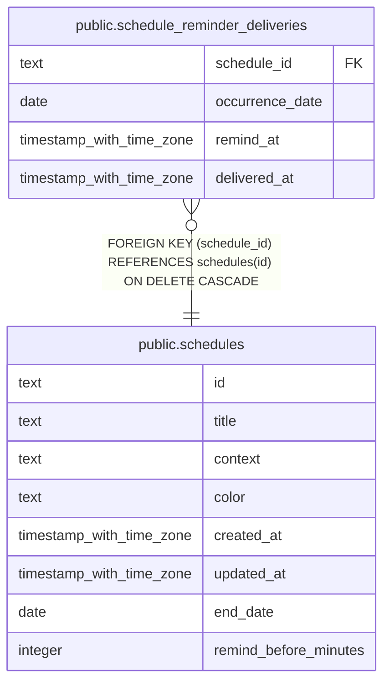

# public.schedule_reminder_deliveries

## Description

Claimed push reminders for individual schedule occurrences.

## Columns

| Name            | Type                     | Default | Nullable | Children | Parents                                 | Comment                                                            |
| --------------- | ------------------------ | ------- | -------- | -------- | --------------------------------------- | ------------------------------------------------------------------ |
| schedule_id     | text                     |         | false    |          | [public.schedules](public.schedules.md) | Schedule series whose occurrence reminder was claimed.             |
| occurrence_date | date                     |         | false    |          |                                         | Original local date of the occurrence, before a move override.     |
| remind_at       | timestamp with time zone |         | false    |          |                                         | Instant at which the occurrence reminder was scheduled to be sent. |
| delivered_at    | timestamp with time zone | now()   | false    |          |                                         | Time when this reminder delivery was claimed.                      |

## Constraints

| Name                                                            | Type        | Definition                                                           |
| --------------------------------------------------------------- | ----------- | -------------------------------------------------------------------- |
| schedule_reminder_deliveries_delivered_at_not_null              | n           | NOT NULL delivered_at                                                |
| schedule_reminder_deliveries_occurrence_date_not_null           | n           | NOT NULL occurrence_date                                             |
| schedule_reminder_deliveries_remind_at_not_null                 | n           | NOT NULL remind_at                                                   |
| schedule_reminder_deliveries_schedule_id_not_null               | n           | NOT NULL schedule_id                                                 |
| schedule_reminder_deliveries_schedule_id_schedules_id_fk        | FOREIGN KEY | FOREIGN KEY (schedule_id) REFERENCES schedules(id) ON DELETE CASCADE |
| schedule_reminder_deliveries_schedule_id_occurrence_date_remind | PRIMARY KEY | PRIMARY KEY (schedule_id, occurrence_date, remind_at)                |

## Indexes

| Name                                                            | Definition                                                                                                                                                                       |
| --------------------------------------------------------------- | -------------------------------------------------------------------------------------------------------------------------------------------------------------------------------- |
| schedule_reminder_deliveries_schedule_id_occurrence_date_remind | CREATE UNIQUE INDEX schedule_reminder_deliveries_schedule_id_occurrence_date_remind ON public.schedule_reminder_deliveries USING btree (schedule_id, occurrence_date, remind_at) |
| idx_schedule_reminder_deliveries_delivered_at                   | CREATE INDEX idx_schedule_reminder_deliveries_delivered_at ON public.schedule_reminder_deliveries USING btree (delivered_at)                                                     |

## Relations

---

> Generated by [tbls](https://github.com/k1LoW/tbls)
