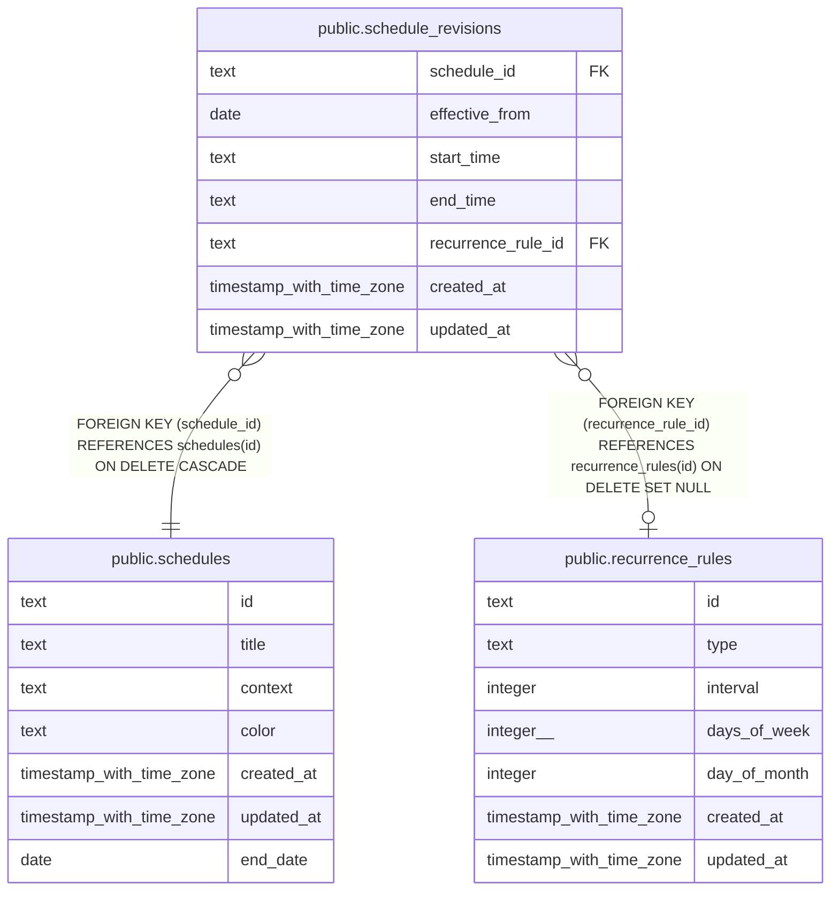

# public.schedule_revisions

## Description

Date-effective local time and recurrence settings for a calendar schedule.

## Columns

| Name               | Type                     | Default | Nullable | Children | Parents                                               | Comment                                                                        |
| ------------------ | ------------------------ | ------- | -------- | -------- | ----------------------------------------------------- | ------------------------------------------------------------------------------ |
| schedule_id        | text                     |         | false    |          | [public.schedules](public.schedules.md)               | Schedule series whose settings are revised.                                    |
| effective_from     | date                     |         | false    |          |                                                       | First local calendar date on which this revision applies.                      |
| start_time         | text                     |         | false    |          |                                                       | Local start time in 24-hour HH:MM format.                                      |
| end_time           | text                     |         | false    |          |                                                       | Local end time in 24-hour HH:MM format.                                        |
| recurrence_rule_id | text                     |         | true     |          | [public.recurrence_rules](public.recurrence_rules.md) | Recurrence rule associated with this revision; null for a one-time occurrence. |
| created_at         | timestamp with time zone | now()   | false    |          |                                                       |                                                                                |
| updated_at         | timestamp with time zone | now()   | false    |          |                                                       |                                                                                |

## Constraints

| Name                                                         | Type        | Definition                                                                          |
| ------------------------------------------------------------ | ----------- | ----------------------------------------------------------------------------------- |
| schedule_revisions_created_at_not_null                       | n           | NOT NULL created_at                                                                 |
| schedule_revisions_effective_from_not_null                   | n           | NOT NULL effective_from                                                             |
| schedule_revisions_end_time_format_check                     | CHECK       | CHECK ((end_time ~ '^([01][0-9]\|2[0-3]):[0-5][0-9]$'::text))                       |
| schedule_revisions_end_time_not_null                         | n           | NOT NULL end_time                                                                   |
| schedule_revisions_schedule_id_not_null                      | n           | NOT NULL schedule_id                                                                |
| schedule_revisions_start_time_format_check                   | CHECK       | CHECK ((start_time ~ '^([01][0-9]\|2[0-3]):[0-5][0-9]$'::text))                     |
| schedule_revisions_start_time_not_null                       | n           | NOT NULL start_time                                                                 |
| schedule_revisions_updated_at_not_null                       | n           | NOT NULL updated_at                                                                 |
| schedule_revisions_recurrence_rule_id_recurrence_rules_id_fk | FOREIGN KEY | FOREIGN KEY (recurrence_rule_id) REFERENCES recurrence_rules(id) ON DELETE SET NULL |
| schedule_revisions_schedule_id_schedules_id_fk               | FOREIGN KEY | FOREIGN KEY (schedule_id) REFERENCES schedules(id) ON DELETE CASCADE                |
| schedule_revisions_schedule_id_effective_from_pk             | PRIMARY KEY | PRIMARY KEY (schedule_id, effective_from)                                           |

## Indexes

| Name                                             | Definition                                                                                                                                  |
| ------------------------------------------------ | ------------------------------------------------------------------------------------------------------------------------------------------- |
| schedule_revisions_schedule_id_effective_from_pk | CREATE UNIQUE INDEX schedule_revisions_schedule_id_effective_from_pk ON public.schedule_revisions USING btree (schedule_id, effective_from) |
| idx_schedule_revisions_recurrence_rule_id        | CREATE INDEX idx_schedule_revisions_recurrence_rule_id ON public.schedule_revisions USING btree (recurrence_rule_id)                        |

## Relations

---

> Generated by [tbls](https://github.com/k1LoW/tbls)
