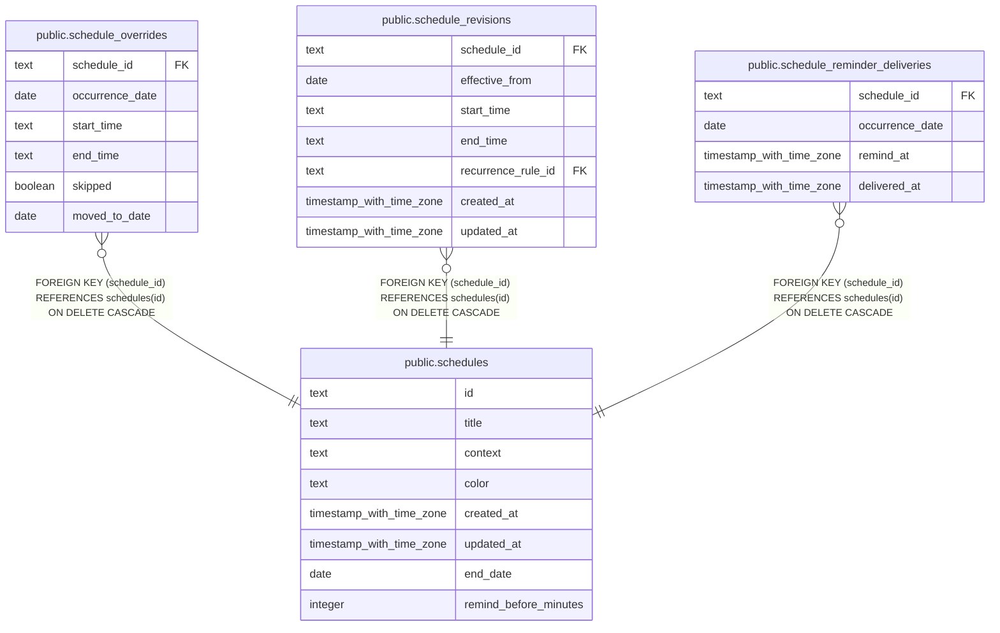

# public.schedules

## Description

Calendar schedule series with optional local end date and push reminders.

## Columns

| Name                  | Type                     | Default          | Nullable | Children                                                                                                                                                                                          | Parents | Comment                                                                                 |
| --------------------- | ------------------------ | ---------------- | -------- | ------------------------------------------------------------------------------------------------------------------------------------------------------------------------------------------------- | ------- | --------------------------------------------------------------------------------------- |
| id                    | text                     |                  | false    | [public.schedule_overrides](public.schedule_overrides.md) [public.schedule_revisions](public.schedule_revisions.md) [public.schedule_reminder_deliveries](public.schedule_reminder_deliveries.md) |         |                                                                                         |
| title                 | text                     |                  | false    |                                                                                                                                                                                                   |         | Human-readable schedule title.                                                          |
| context               | text                     | 'personal'::text | false    |                                                                                                                                                                                                   |         | Whether the schedule belongs to the work or personal context.                           |
| color                 | text                     |                  | true     |                                                                                                                                                                                                   |         | Optional color value associated with the schedule.                                      |
| created_at            | timestamp with time zone | now()            | false    |                                                                                                                                                                                                   |         |                                                                                         |
| updated_at            | timestamp with time zone | now()            | false    |                                                                                                                                                                                                   |         |                                                                                         |
| end_date              | date                     |                  | true     |                                                                                                                                                                                                   |         | Last local calendar date on which the schedule can occur; null for no end date.         |
| remind_before_minutes | integer                  |                  | true     |                                                                                                                                                                                                   |         | Minutes before each occurrence starts to send a push reminder; null disables reminders. |

## Constraints

| Name                                  | Type        | Definition                                                                 |
| ------------------------------------- | ----------- | -------------------------------------------------------------------------- |
| schedules_context_not_null            | n           | NOT NULL context                                                           |
| schedules_created_at_not_null         | n           | NOT NULL created_at                                                        |
| schedules_id_not_null                 | n           | NOT NULL id                                                                |
| schedules_remind_before_minutes_check | CHECK       | CHECK (((remind_before_minutes >= 0) AND (remind_before_minutes <= 1440))) |
| schedules_title_not_null              | n           | NOT NULL title                                                             |
| schedules_updated_at_not_null         | n           | NOT NULL updated_at                                                        |
| schedules_pkey                        | PRIMARY KEY | PRIMARY KEY (id)                                                           |

## Indexes

| Name                  | Definition                                                                   |
| --------------------- | ---------------------------------------------------------------------------- |
| schedules_pkey        | CREATE UNIQUE INDEX schedules_pkey ON public.schedules USING btree (id)      |
| idx_schedules_context | CREATE INDEX idx_schedules_context ON public.schedules USING btree (context) |

## Relations

---

> Generated by [tbls](https://github.com/k1LoW/tbls)
