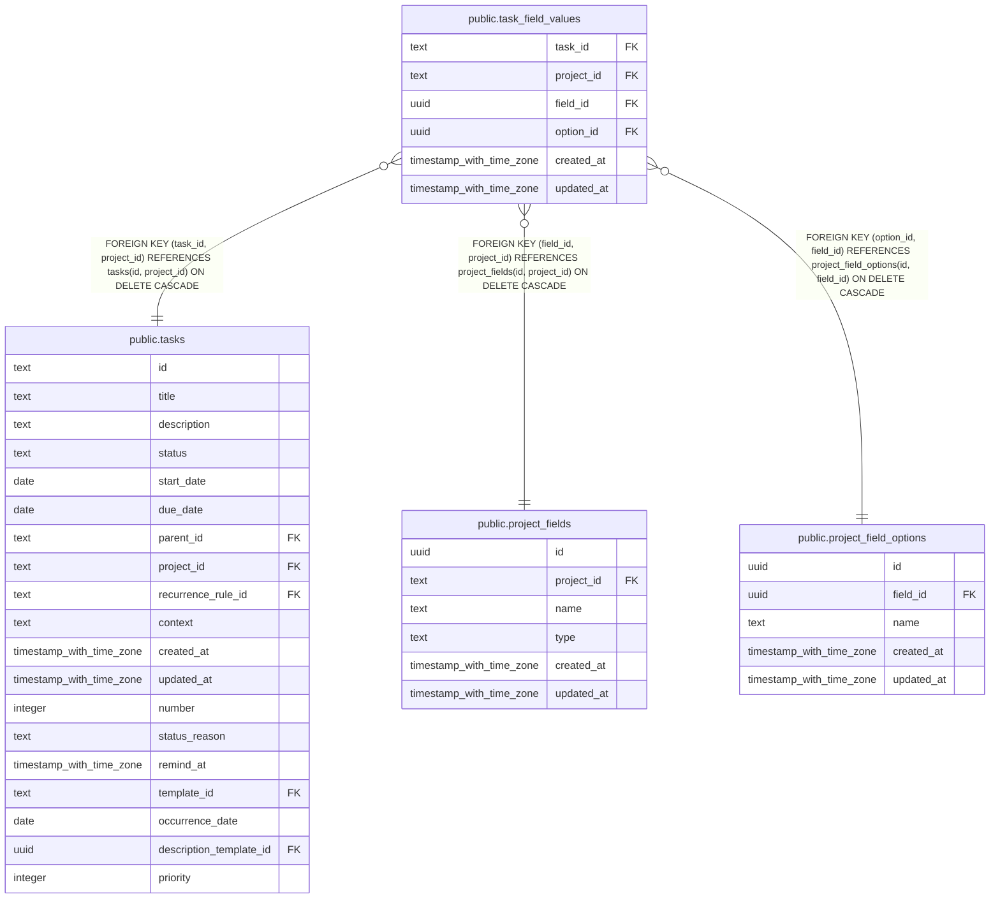

# public.task_field_values

## Description

Single-select custom field values assigned to tasks.

## Columns

| Name       | Type                     | Default | Nullable | Children | Parents                                                                                                           | Comment                                                   |
| ---------- | ------------------------ | ------- | -------- | -------- | ----------------------------------------------------------------------------------------------------------------- | --------------------------------------------------------- |
| task_id    | text                     |         | false    |          | [public.tasks](public.tasks.md)                                                                                   | Task that owns this field value.                          |
| project_id | text                     |         | false    |          | [public.project_fields](public.project_fields.md) [public.tasks](public.tasks.md)                                 | Project that scopes the task, field, and selected option. |
| field_id   | uuid                     |         | false    |          | [public.project_field_options](public.project_field_options.md) [public.project_fields](public.project_fields.md) | Custom field receiving the selected option.               |
| option_id  | uuid                     |         | false    |          | [public.project_field_options](public.project_field_options.md)                                                   | Selected option for the custom field.                     |
| created_at | timestamp with time zone | now()   | false    |          |                                                                                                                   |                                                           |
| updated_at | timestamp with time zone | now()   | false    |          |                                                                                                                   |                                                           |

## Constraints

| Name                                  | Type        | Definition                                                                                         |
| ------------------------------------- | ----------- | -------------------------------------------------------------------------------------------------- |
| task_field_values_created_at_not_null | n           | NOT NULL created_at                                                                                |
| task_field_values_field_id_not_null   | n           | NOT NULL field_id                                                                                  |
| task_field_values_option_id_not_null  | n           | NOT NULL option_id                                                                                 |
| task_field_values_project_id_not_null | n           | NOT NULL project_id                                                                                |
| task_field_values_task_id_not_null    | n           | NOT NULL task_id                                                                                   |
| task_field_values_updated_at_not_null | n           | NOT NULL updated_at                                                                                |
| fk_task_field_values_option_field     | FOREIGN KEY | FOREIGN KEY (option_id, field_id) REFERENCES project_field_options(id, field_id) ON DELETE CASCADE |
| fk_task_field_values_field_project    | FOREIGN KEY | FOREIGN KEY (field_id, project_id) REFERENCES project_fields(id, project_id) ON DELETE CASCADE     |
| task_field_values_task_id_field_id_pk | PRIMARY KEY | PRIMARY KEY (task_id, field_id)                                                                    |
| fk_task_field_values_task_project     | FOREIGN KEY | FOREIGN KEY (task_id, project_id) REFERENCES tasks(id, project_id) ON DELETE CASCADE               |

## Indexes

| Name                                  | Definition                                                                                                            |
| ------------------------------------- | --------------------------------------------------------------------------------------------------------------------- |
| task_field_values_task_id_field_id_pk | CREATE UNIQUE INDEX task_field_values_task_id_field_id_pk ON public.task_field_values USING btree (task_id, field_id) |

## Relations

---

> Generated by [tbls](https://github.com/k1LoW/tbls)
