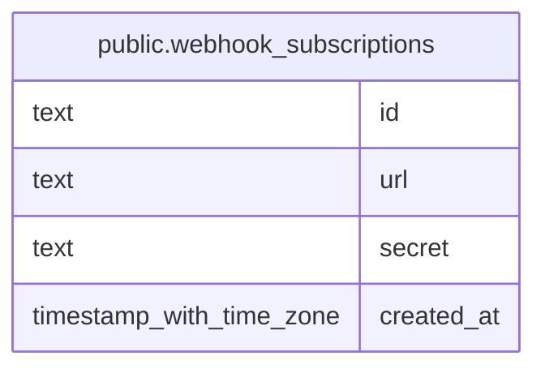

# public.webhook_subscriptions

## Description

Endpoints subscribed to task status events.

## Columns

| Name       | Type                     | Default | Nullable | Children | Parents | Comment                                                 |
| ---------- | ------------------------ | ------- | -------- | -------- | ------- | ------------------------------------------------------- |
| id         | text                     |         | false    |          |         |                                                         |
| url        | text                     |         | false    |          |         | HTTP or HTTPS endpoint that receives subscribed events. |
| secret     | text                     |         | false    |          |         | Secret used to sign event payloads with HMAC-SHA256.    |
| created_at | timestamp with time zone | now()   | false    |          |         |                                                         |

## Constraints

| Name                                      | Type        | Definition          |
| ----------------------------------------- | ----------- | ------------------- |
| webhook_subscriptions_created_at_not_null | n           | NOT NULL created_at |
| webhook_subscriptions_id_not_null         | n           | NOT NULL id         |
| webhook_subscriptions_secret_not_null     | n           | NOT NULL secret     |
| webhook_subscriptions_url_not_null        | n           | NOT NULL url        |
| webhook_subscriptions_pkey                | PRIMARY KEY | PRIMARY KEY (id)    |

## Indexes

| Name                       | Definition                                                                                      |
| -------------------------- | ----------------------------------------------------------------------------------------------- |
| webhook_subscriptions_pkey | CREATE UNIQUE INDEX webhook_subscriptions_pkey ON public.webhook_subscriptions USING btree (id) |

## Relations

---

> Generated by [tbls](https://github.com/k1LoW/tbls)
